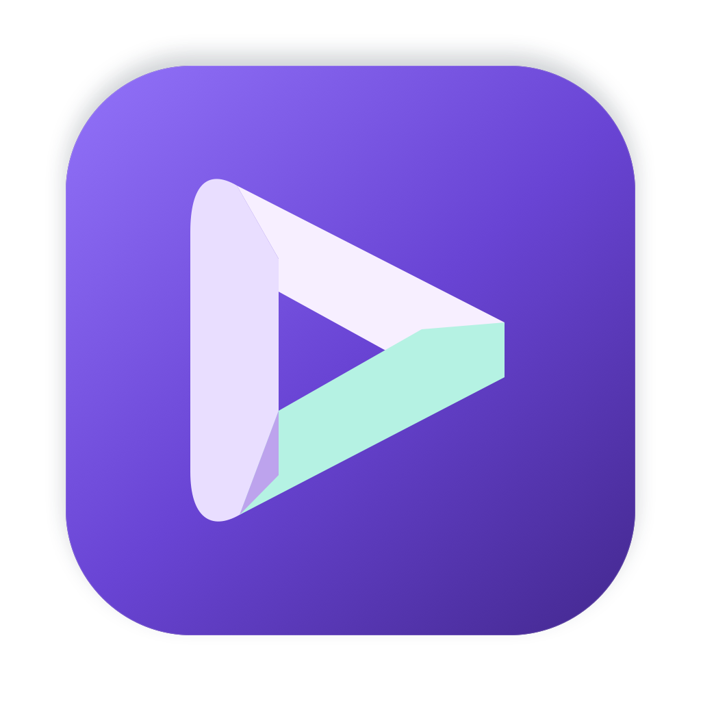

# Cueframe



A native macOS recorder with a movable squircle webcam, microphone narration, optional Mac audio, and editable AI zoom suggestions. This fork retains [Daniel Oquelis’s EasyDemo](https://github.com/danieloquelis/EasyDemo) history and MIT license.

Requires **macOS 15.2 or later** and Xcode 16 or later to build. This version uses ScreenCaptureKit’s separate screen, microphone, and Mac audio outputs and AVFoundation camera capture.

## Build and install

```sh
git clone https://github.com/JoshuaColePhD/CueFrame.git
cd CueFrame
./scripts/build-local.sh --install
open "/Applications/CueFrame.app"
```

The script builds a locally signed Release app, verifies its signature, and creates `build/Cueframe-Mac.zip`. It remembers the selected local code-signing certificate in the ignored `build/signing-identity` file, or uses ad-hoc signing when none exists. No provisioning profile is needed for this personal build. It is not a notarized public distribution. Quit an older personal build before reinstalling. The original `com.easydemo` app has a different identifier and remains separate.

For reliable screen permissions across rebuilds, select the same stable code-signing certificate each time, for example `EASYDEMO_SIGN_IDENTITY="Flow Personal Local" ./scripts/build-local.sh --install` on this Mac. Ad-hoc builds change signing identity when their contents change, which can invalidate macOS privacy grants even when System Settings shows the switch enabled. When building directly in Xcode, use the same certificate in Signing settings.

Build output defaults to the system temporary directory to avoid cloud-file-provider Finder metadata interfering with signature verification. The ZIP stays in this workspace’s `build` folder. For a Debug build, set `CONFIGURATION=Debug`. Open `EasyDemo.xcodeproj` to work in Xcode. The installed Release identifier is `com.joshuacole.easydemo`; Debug/tests use `com.joshuacole.easydemo.debug` so development launches cannot replace the installed app’s privacy identity.

Cueframe keeps this fork’s existing bundle identifiers, Keychain service, and recording storage path so the rename preserves permissions, projects, and preferences. The local installer installs `/Applications/CueFrame.app`, upgrades an existing personal installation, and retains its old bundle under the ignored `build/previous-installations` folder.

Cueframe’s logo is a folded play mark in lavender and mint on violet. Its editable vector is [assets/branding/Cueframe.svg](assets/branding/Cueframe.svg). Regenerate all macOS sizes with `swift scripts/generate-icon.swift`.

## Record

1. Use **Choose window** or **Choose display** to open Apple’s built-in sharing picker. macOS authorizes the selected content for that capture session; the app does not require a successful global screen-permission preflight check.
2. Check your microphone level. Choose a microphone and camera; permission requests appear when those inputs are used.
3. Webcam and microphone start enabled. Mac audio is an independent toggle, initially off. For a window recording, audio follows the selected source; headphones prevent speaker sound from entering the microphone twice.
4. Choose **Custom** webcam position to drag the overlay in the layout preview. Screen capture starts when you press Record; the editor provides the actual rendered video preview. The squircle preview and export use the same shape path.
5. Start and stop with **⇧⌘R**, or use the menu bar stop button. A pending device-permission request has a **Cancel startup** action. Choose a fresh source for each recording session. Stopping opens the edit review.

Export defaults to 1080p, 30 fps, H.264 MP4. Screen source tracks retain up to 4K detail for zooming. HEVC and ProRes exports use MOV. Settings persist between launches. The recorder saves source media automatically in its sandbox’s Application Support directory; **Recordings** reopens projects and **Show source files** reveals their location.

## AI editing

Open **Cueframe → Settings** (⌘,) and save your OpenAI API key in macOS Keychain. It never belongs in source code or a `.env` file.

After recording, choose **Generate AI Edit**. This explicitly sends JPEG screen samples, click coordinates, and microphone audio directly to OpenAI. Camera video and Mac audio stay local. API use is billed to your own OpenAI project. There are no API calls during recording or simply opening a preview.

The editor uses `gpt-transcribe` for 30-second narration chunks and `gpt-6.1-sol` with structured output for zoom suggestions in one-minute sections. Completed transcript chunks are cached so failed requests can resume. Visual suggestions are validated before use. Narration timestamps describe chunks, not exact words.

Review zoom timing, scale, and horizontal/vertical targets. Disable a suggestion to undo it. **Find locally** suggests pauses longer than two seconds only when microphone silence, screen inactivity, cursor inactivity, and optional Mac audio silence have been observed. Missing observations are kept. Pause suggestions retain 0.3 seconds at either end; turn a trim off to restore the pause.

Use **Preview changes** after adjusting suggestions. **Compare original** shows the unedited composition. Preview and export share a compositor: screen zooms do not enlarge or move the webcam. Edits are saved with the project, and original tracks are never replaced. Export writes a temporary output and replaces the chosen destination only after success. Without an API key, manual zooms, local pause detection, preview, and export remain available.

A recording interrupted by a device or writer error retains its project and finalized source tracks. Force-quitting or losing power can leave an unfinished MOV that cannot be played; this version does not promise recovery of unfinished media containers.

## Development and tests

```sh
xcodebuild -project EasyDemo.xcodeproj -scheme EasyDemo \
  -configuration Debug -derivedDataPath build/DerivedData \
  -only-testing:EasyDemoTests test
```

Tests cover timeline cuts, settings and project persistence, conservative pause detection, AI response validation and request cancellation, export failure safety, a camera/voice composite, and a ten-minute synthetic timeline. Synthetic timing checks do not establish microphone/camera hardware drift. See [verification evidence](docs/VERIFICATION.md) for the checks actually completed on this Mac.

The upstream README is preserved in [docs/UPSTREAM.md](docs/UPSTREAM.md). Upstream App Store Fastlane files remain historical; this fork’s CI and local build use ad-hoc signing without deployment secrets.
